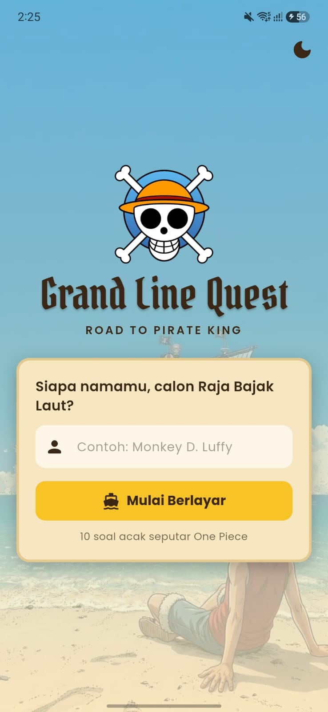
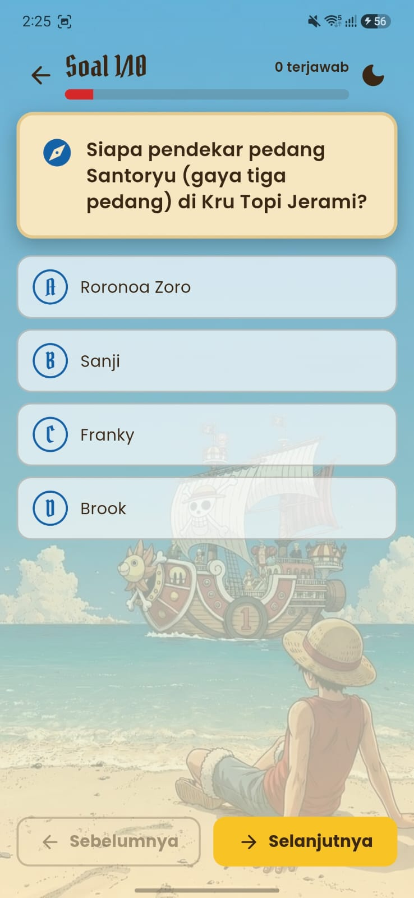
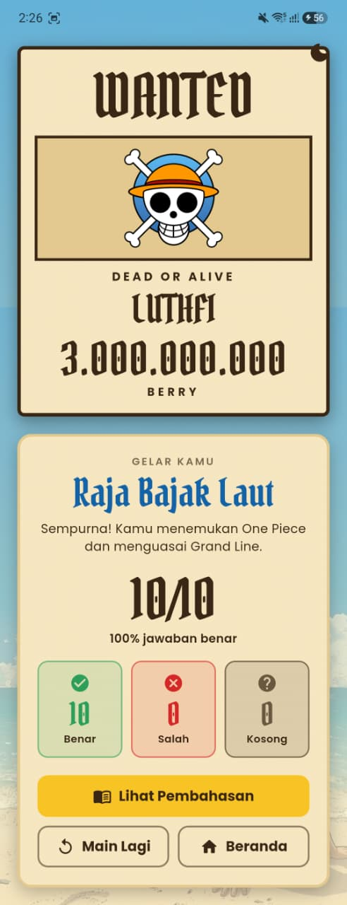
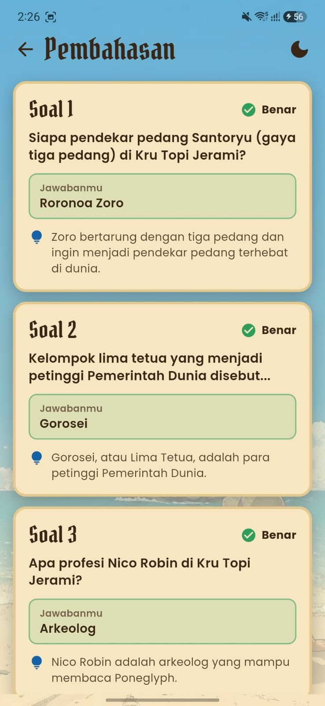
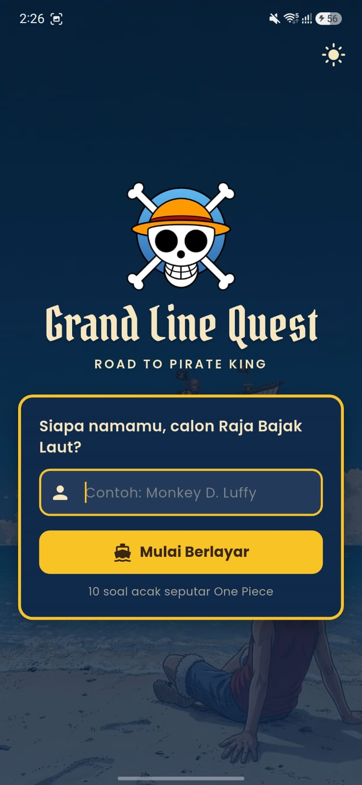
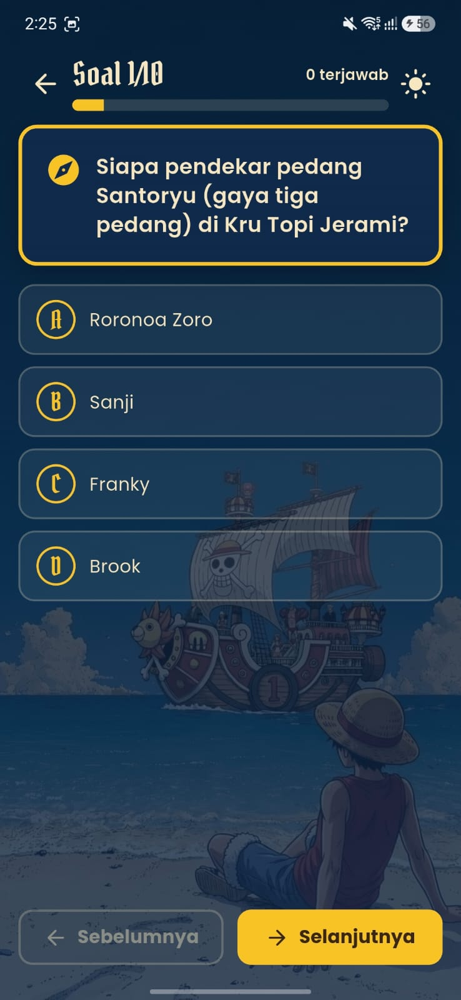
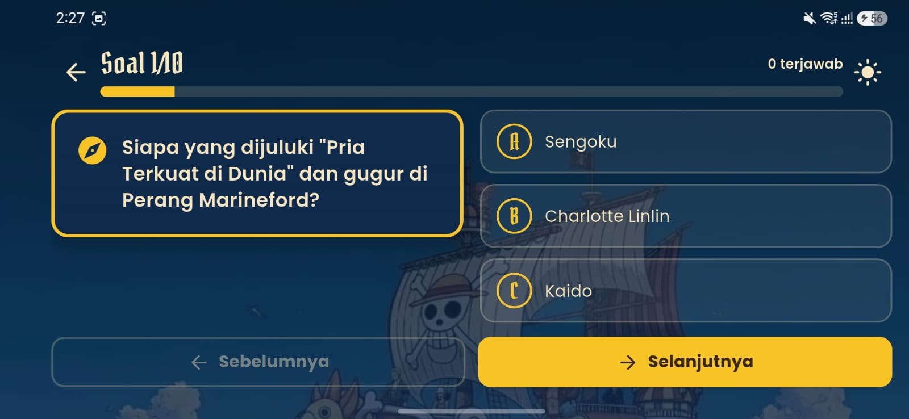
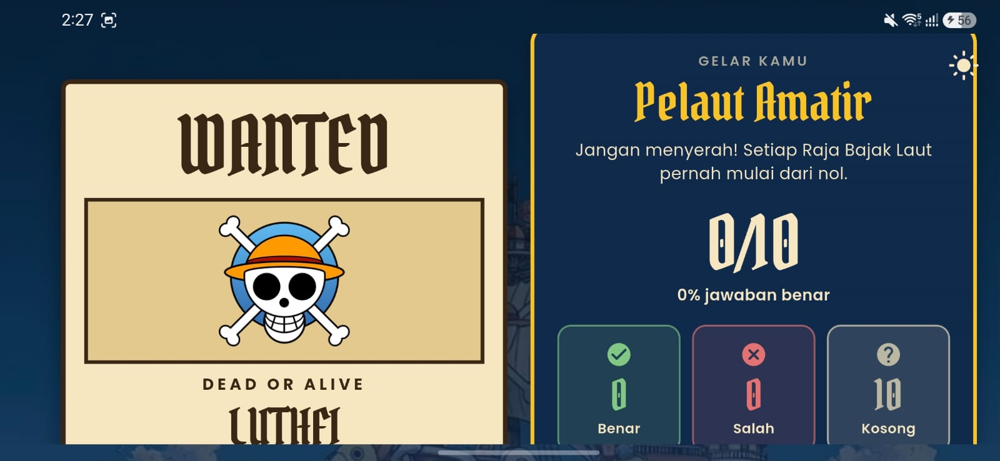

# 🏴‍☠️ Grand Line Quest

> *Road to Pirate King* — kuis pilihan ganda bertema One Piece.

Aplikasi Flutter untuk **UTS Lab Pemrograman Mobile**, Program Studi Ilmu Komputer, Universitas Sumatera Utara (Semester Ganjil T.A. 2026/2027).

## 👤 Identitas Mahasiswa

| | |
|---|---|
| **Nama** | LUTHFI NAUFALDI |
| **NIM** | 241401036 |
| **Lab** | Pemrograman Mobile (PM 5) |

## 📱 Informasi Aplikasi

**Nama aplikasi:** Grand Line Quest

**Deskripsi singkat:** Pengguna memasukkan nama panggilan bajak lautnya, menjawab 10 soal pilihan ganda seputar One Piece, lalu melihat skor akhir dalam bentuk poster buronan (WANTED) lengkap dengan bounty dan gelar bajak laut. Seluruh jawaban dapat ditinjau kembali di halaman pembahasan.

### Fitur

**Fitur wajib**
- Halaman: Beranda, Kuis, Hasil, dan Pembahasan, dengan navigasi antar-halaman (*named routes*).
- Kombinasi `StatelessWidget` dan `StatefulWidget` sesuai kebutuhan.
- Reusable widget di file terpisah (`lib/widgets/`).
- Aset gambar dan ikon, serta font kustom (Pirata One dan Poppins).
- Ukuran elemen UI dinamis mengikuti layar (helper `context.sz()` / `context.sp()`).
- State management dengan **Provider**: progres jawaban tidak hilang saat layar diputar atau berpindah halaman.
- Data soal lokal (tanpa database).

**Fitur tambahan**
- 10 soal diambil acak dari 15 soal, dan urutan pilihan jawaban juga diacak.
- Jawaban bisa diganti sebelum kuis diselesaikan; progress bar dan penghitung soal terjawab.
- Tombol **Lanjutkan** di Beranda untuk melanjutkan kuis yang belum selesai.
- Konfirmasi saat menyelesaikan kuis dengan soal yang masih kosong.
- Hasil berupa poster **WANTED** (bounty dihitung dari jumlah jawaban benar), gelar bajak laut, dan statistik benar/salah/kosong.
- Halaman **Pembahasan** berisi jawaban pemain, jawaban benar, dan penjelasan tiap soal.
- Penjaga rute: halaman yang dibuka tanpa data (mis. *refresh* di web) kembali ke Beranda.

**Bonus**
- **Dual-theme**: mode terang (siang) dan gelap (malam) dengan tombol di setiap halaman.
- **Adaptive & responsive**: tampilan 2 kolom di tablet/landscape pada halaman Kuis dan Hasil, serta lebar konten dibatasi agar tetap rapi di web.

## 🛠️ Teknologi

- Flutter (Dart)
- Provider (state management)
- Font: Pirata One dan Poppins

## 🗂️ Struktur Proyek

```text
lib/
├── main.dart                    # Entry point, Provider, tema, dan rute
├── core/
│   ├── constants/               # Nama app, rute, path aset
│   ├── theme/                   # Warna, tema light/dark, gaya teks
│   └── utils/                   # Helper responsive & format angka
├── data/
│   ├── models/                  # Question, PirateRank
│   └── question_bank.dart       # Bank soal lokal
├── providers/                   # QuizProvider, ThemeProvider
├── screens/                     # Home, Quiz, Result, Review
└── widgets/                     # Reusable widget
    ├── ocean_background.dart
    ├── pirate_scaffold.dart
    ├── pirate_card.dart
    ├── pirate_button.dart
    ├── theme_toggle_button.dart
    ├── option_tile.dart
    ├── wanted_poster.dart
    ├── stat_chip.dart
    └── review_tile.dart
```

## ▶️ Cara Menjalankan

```bash
flutter pub get
flutter run
```

## 📚 Dokumentasi

### Screenshot

Diambil dari HP Android fisik.

| Beranda | Kuis | Hasil | Pembahasan |
|:---:|:---:|:---:|:---:|
|  |  |  |  |

**Mode gelap (dual-theme)**

| Beranda | Kuis |
|:---:|:---:|
|  |  |

**Layar lebar / landscape (adaptive & responsive)**

| Kuis | Hasil |
|:---:|:---:|
|  |  |

### Perangkat Pengujian

| Perangkat | Keterangan |
|---|---|
| HP Android fisik | Samsung Galaxy A55, Android 16 (diuji portrait & landscape) |
| Google Chrome (web view) | Jendela dilebarkan dan dipersempit untuk menguji responsivitas |

### Mockup / Prototype

🔗 [Lihat prototype di Figma](https://www.figma.com/design/790TL6fmm7ZHmbyxIy3FGm/Untitled?t=f50mddlSoQhAaIyy-1)

> Dibuat dengan Figma Make (AI) berdasarkan rancangan aplikasi.
Buka dengan akun Figma untuk menjalankan prototype interaktif.

### Credit Aset

| Aset | Sumber / Lisensi |
|---|---|
| Font **Pirata One** | [Google Fonts](https://fonts.google.com/specimen/Pirata+One), SIL Open Font License |
| Font **Poppins** | [Google Fonts](https://fonts.google.com/specimen/Poppins), SIL Open Font License |
| `assets/images/logo.png` | [John D.](https://www.freepnglogos.com/images/one-piece-logo-75.html) |
| `assets/images/bg_ocean.jpg` | [Latte](https://pin.it/2S8qAQ6OF) |
| Ikon | Material Icons (bawaan Flutter) |
| Package `provider` | [pub.dev/packages/provider](https://pub.dev/packages/provider) |
| Soal & penjelasan | Disusun berdasarkan pengetahuan umum seri *One Piece* |
| Mockup/prototype | Dibuat dengan Figma Make (Figma) |

*One Piece* © Eiichiro Oda / Shueisha. Aplikasi ini adalah proyek pembelajaran non-komersial dan tidak berafiliasi dengan pemilik hak cipta.
